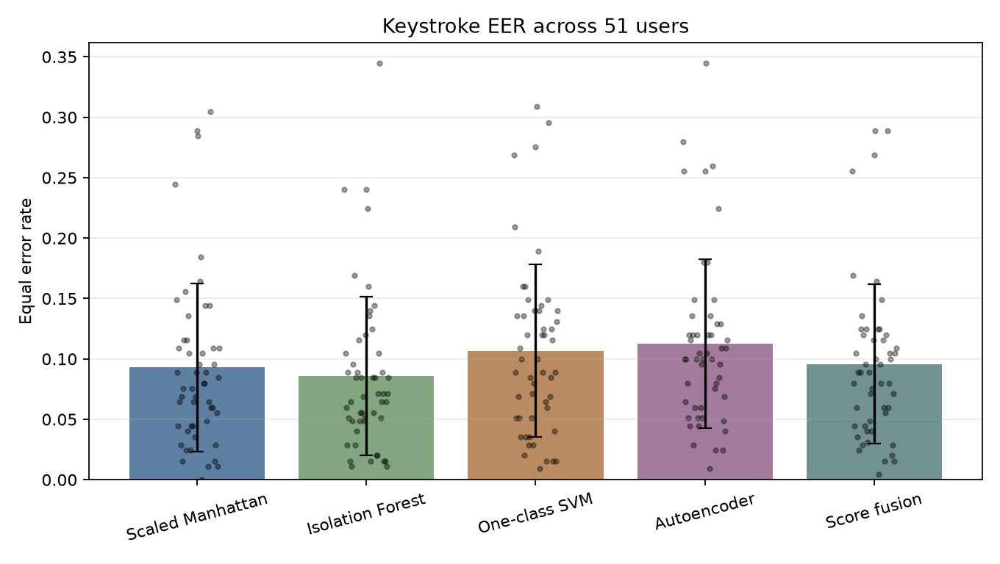
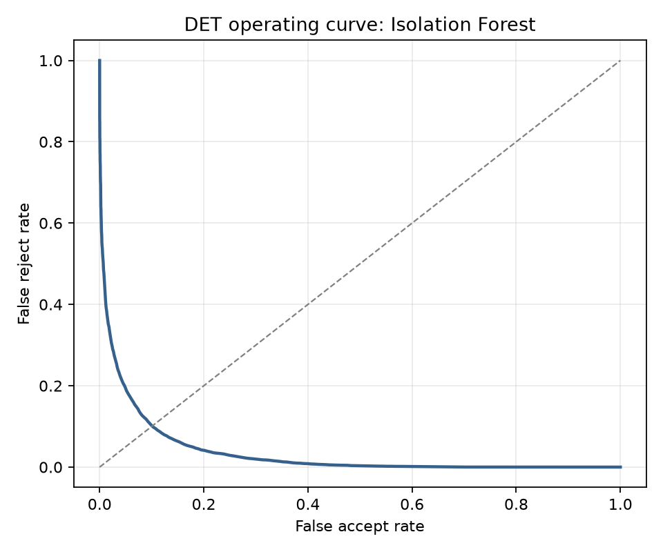
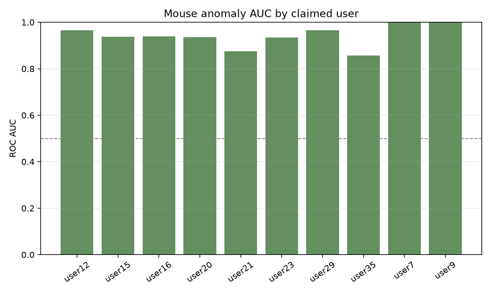
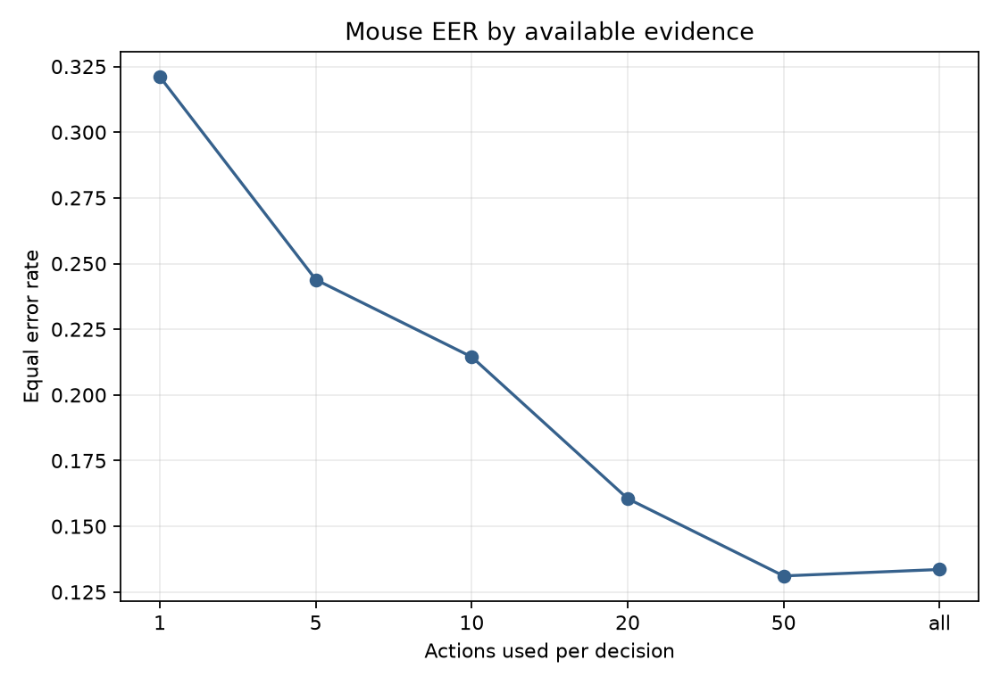
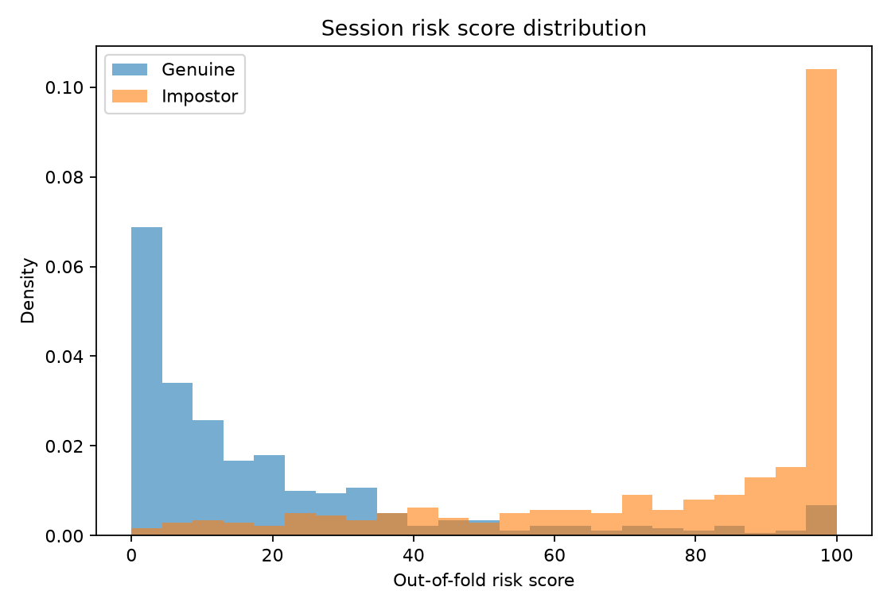
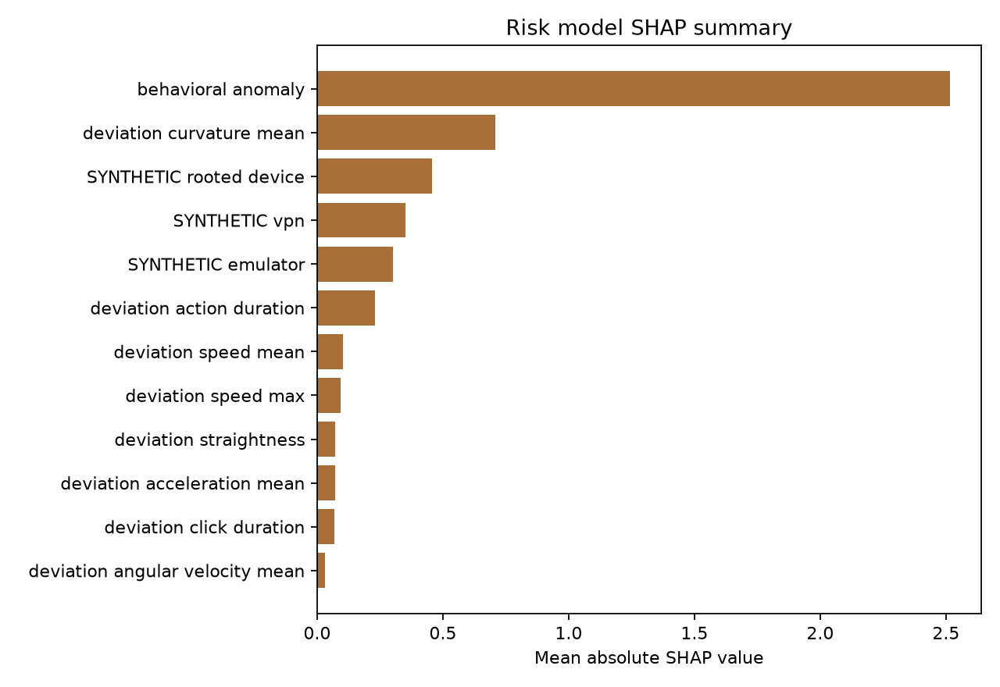
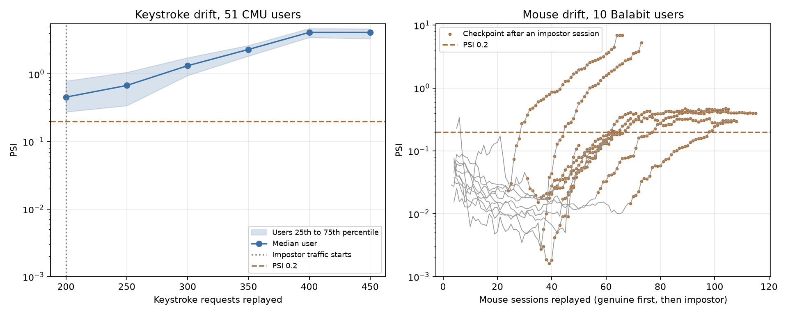

# Keystroke and Mouse Anomaly Detection (CMU, Balabit data)

This project evaluates per-user behavioral anomaly models on the CMU fixed-text keystroke benchmark and the public labeled portion of the Balabit mouse benchmark. `make all` generated every reported value. Full precision values are in [`docs/results.json`](docs/results.json).

The best single keystroke detector was **Isolation Forest**, with mean EER **0.0858 ± 0.0658** across 51 users. Four-detector score fusion reached **0.0958 ± 0.0658**. Mouse anomaly scoring reached global AUC **0.9307**. The selected session risk model was **Logistic regression**, with grouped out-of-fold AUC **0.9222** and EER **0.1360** after behavior, user-relative deviations, and SYNTHETIC device flags were combined.

**Project page:** [abhayjuloori.github.io/keystroke-mouse-anomaly](https://abhayjuloori.github.io/keystroke-mouse-anomaly/), where you can type the benchmark password and see which of the 51 typing templates you match.

## What this project does

- **Keystroke dynamics.** One model per user on the CMU benchmark (51 people, 20,400 typings of `.tie5Roanl`, 31 timing features), with four detectors compared under the original Killourhy and Maxion protocol: scaled Manhattan distance, Isolation Forest, one-class SVM and a PyTorch autoencoder. Each is scored by equal error rate against 250 impostor attempts per user.
- **Mouse dynamics.** Balabit sessions are cut into actions, and every action becomes speed, acceleration, curvature, angular velocity, straightness and click hold time. A per-user model scores how unlike its owner a session looks.
- **Session risk.** The mouse score, per-user feature deviations and three SYNTHETIC device flags (emulator, rooted device, VPN) feed one 0 to 100 risk score. SHAP values on that model become the top three plain-language reasons.
- **Time-aware evaluation.** Later data never trains a model. CMU trains on sessions 1 to 4 and tests on 5 to 8. Balabit files only record time inside each session, so each training session is cut at 70% of its elapsed time: the earlier part fits the model, the later part sets thresholds and the drift reference.
- **Tracking and serving.** Every run goes to MLflow with false accept and false reject rates at fixed thresholds. A FastAPI service scores keystrokes and mouse sessions and exposes a per-user drift check based on PSI.

### Where things live

| Part | Code | `docs/results.json` |
|---|---|---|
| Keystroke protocol and detectors | `src/kma/keystroke.py` (`protocol_split`, `train_keystroke_models`) | `protocol`, `keystroke` |
| Mouse actions and features | `src/kma/mouse.py` (`segment_actions`, `action_features`, `session_deviation_features`) | `mouse`, `mouse_per_user` |
| Risk score and reason codes | `src/kma/risk.py` (`train_risk_model`, `reason_codes`) | `risk` |
| Time split and leakage checks | `src/kma/splits.py` (`time_split_actions`), `src/kma/keystroke.py` | `time_split` |
| MLflow logging and read-back | `src/kma/pipeline.py` (`_verify_mlflow_metrics`) | `mlflow_metric_verification` |
| API and drift | `src/kma/api.py`, `src/kma/metrics.py` (`population_stability_index`) | `api_latency`, `drift_demo` |

## Keystroke results

Scores are normalized against each user's enrollment data. Fusion averages the four normalized detector scores. FAR and FRR use thresholds fixed at enrollment-score percentiles.

| Detector | Mean EER ± std | p90 FAR / FRR | p95 FAR / FRR | p99 FAR / FRR |
|---|---:|---:|---:|---:|
| Scaled Manhattan | 0.0931 ± 0.0697 | 0.0946 / 0.1425 | 0.1787 / 0.0662 | 0.3974 / 0.0167 |
| Isolation Forest | 0.0858 ± 0.0658 | 0.1213 / 0.0904 | 0.2192 / 0.0387 | 0.4612 / 0.0078 |
| One-class SVM | 0.1068 ± 0.0714 | 0.0256 / 0.4674 | 0.0256 / 0.4672 | 0.0257 / 0.4670 |
| Autoencoder | 0.1127 ± 0.0699 | 0.1350 / 0.1217 | 0.2455 / 0.0673 | 0.4986 / 0.0226 |
| Score fusion | 0.0958 ± 0.0658 | 0.0603 / 0.1990 | 0.1110 / 0.1156 | 0.2620 / 0.0455 |





## Mouse anomaly results

Each claimed-user classifier fits only early enrollment actions from `training_files`. The fixed threshold is the 95th percentile of the later, unseen portion of those same training sessions. Across full labeled test sessions, the per-user fixed thresholds produced FAR **0.0667** and FRR **0.3358**.

| User | Genuine | Impostor | AUC | EER | Time hold-out p95 | FAR | FRR |
|---|---:|---:|---:|---:|---:|---:|---:|
| user12 | 56 | 49 | 0.9657 | 0.1046 | 0.5466 | 0.0204 | 0.3571 |
| user15 | 45 | 70 | 0.9384 | 0.1310 | 0.5457 | 0.0571 | 0.2667 |
| user16 | 68 | 38 | 0.9396 | 0.1320 | 0.5644 | 0.0000 | 0.3382 |
| user20 | 30 | 20 | 0.9367 | 0.1000 | 0.6748 | 0.0000 | 0.3667 |
| user21 | 37 | 22 | 0.8747 | 0.1855 | 0.5454 | 0.0909 | 0.4595 |
| user23 | 38 | 33 | 0.9338 | 0.1264 | 0.5656 | 0.0000 | 0.3421 |
| user29 | 43 | 20 | 0.9651 | 0.0965 | 0.5286 | 0.0000 | 0.3721 |
| user35 | 35 | 73 | 0.8575 | 0.2867 | 0.5850 | 0.2740 | 0.2857 |
| user7 | 36 | 37 | 1.0000 | 0.0000 | 0.4046 | 0.0000 | 0.2778 |
| user9 | 23 | 43 | 1.0000 | 0.0000 | 0.3180 | 0.0000 | 0.2609 |

Global mouse AUC is **0.9307**. Mean per-user AUC is **0.9412 ± 0.0443**. Mean per-user EER is **0.1163 ± 0.0789**.

Using only actions that start after the first 30% of each labeled test session gives AUC **0.9115**, EER **0.1630**, FAR **0.0963**, and FRR **0.3869** at the same per-user fixed thresholds.



### Mouse evidence available per decision

| Actions | EER | FAR at EER point | FRR at EER point |
|---:|---:|---:|---:|
| 1 | 0.3211 | 0.3210 | 0.3212 |
| 5 | 0.2439 | 0.2444 | 0.2433 |
| 10 | 0.2145 | 0.2148 | 0.2141 |
| 20 | 0.1605 | 0.1605 | 0.1606 |
| 50 | 0.1311 | 0.1309 | 0.1314 |
| all | 0.1336 | 0.1333 | 0.1338 |



## Session risk

Eight signed deviation features compare each session with that claimed user's training-session medians and MAD scales. The candidates use identical five-fold GroupKFold splits by claimed user. **Logistic regression** was selected by out-of-fold AUC before the final serving fit.

| Inputs | Grouped out-of-fold AUC | EER |
|---|---:|---:|
| Behavior only | 0.9272 | 0.1360 |
| Behavior plus deviations | 0.9102 | 0.1532 |
| Behavior plus deviations plus synthetic | 0.9222 | 0.1360 |

| Candidate on all inputs | Grouped out-of-fold AUC | EER |
|---|---:|---:|
| Logistic regression | 0.9222 | 0.1360 |
| Gradient-boosted trees | 0.9161 | 0.1311 |

The full risk score has FAR **0.0099** and FRR **0.6521** at its out-of-fold 1% FAR operating point. At the 5% target it has FAR **0.0494** and FRR **0.3577**. Device flags are generated from label-conditional rates in `configs/device_signals.yaml`. These results show a synthetic fusion mechanism, not expected production lift.





## Split and leakage controls

For each CMU subject, sessions 1 through 4 provide 200 enrollment samples and sessions 5 through 8 provide 200 later genuine test samples. The first five time-ordered samples from each other subject provide 250 impostor attempts. No later CMU session enters enrollment.

Balabit files contain only elapsed timestamps within each session, so cross-session chronology cannot be verified. `time_split_actions` places actions that end within the earliest 70% of each training session into enrollment, places actions that start at or after the cut into the time hold-out, and drops actions that straddle the cut. Across all users this produced 42433 enrollment actions, 23005 hold-out actions, and 22 dropped straddlers. All computed leakage checks in `time_split.balabit.leakage_checks` passed. Test files remain fully outside fitting.

The pipeline read its newly written MLflow runs back with `mlflow.search_runs`. It verified these fixed-threshold FAR and FRR metric keys on every applicable keystroke, mouse, and risk run: `fixed_train_time_holdout_p95.far`, `fixed_train_time_holdout_p95.frr`, `mean_far_at_train_p90`, `mean_far_at_train_p95`, `mean_far_at_train_p99`, `mean_frr_at_train_p90`, `mean_frr_at_train_p95`, `mean_frr_at_train_p99`, `operating_points.global_far_1pct.far`, `operating_points.global_far_1pct.frr`, `operating_points.global_far_5pct.far`, `operating_points.global_far_5pct.frr`.

## API and drift

The FastAPI service computes the same user-relative session deviations stored with the mouse artifacts and returns feature-specific SHAP reason codes. `/drift/{user_id}` compares a rolling window of that user's served scores against a reference of genuine scores the model never fit on. Keystroke users keep the last 200 sample scores, and the reference is out-of-sample scores from leave-one-session-out folds within sessions 1 through 4. Mouse users keep the last 2000 per-action anomaly scores, and the reference is the later-in-time 30% hold-out of each training session. No verdict is given below 164 keystroke scores or 200 mouse action scores.

Measured with 200 TestClient requests per endpoint on real artifacts:

| Endpoint | p50 ms | p95 ms |
|---|---:|---:|
| `/score/keystroke` | 1.0698 | 1.2191 |
| `/score/session` | 30.8967 | 32.5688 |

The drift replay sends each user's genuine test traffic through the API, then impostor traffic, and reads `/drift` at each checkpoint. PSI uses reference quantile bins with open ends and additive smoothing of 0.5.

| Channel | Users | Median PSI, genuine | Median PSI, impostor | False drift rate at PSI 0.2 (genuine checkpoints) | Detection rate at PSI 0.2 (window fully impostor) |
|---|---:|---:|---:|---:|---:|
| Keystroke (CMU sessions 5 to 8, then other users) | 51 | 0.4544 | 2.3187 | 0.8431 | 1.0000 |
| Mouse (labeled genuine, then impostor sessions) | 10 | 0.0168 | 0.2150 | 0.0053 | 1.0000 |

Minimum windows come from sampling noise, not from the replay outcome. With 10 bins, a window of n scores and a reference of m scores, PSI under no real change is about 9 x (1/n + 1/m). The minimum window is the smallest n that keeps this at or below half the 0.2 threshold: 164 for keystroke (expected no-change PSI 0.0999). Mouse references hold a median of 2142.5000 hold-out actions per user, so 200 actions gives 0.0492.

Genuine keystroke drift is partly real. The median user's genuine score, relative to the reference median, rises from 1.0113 in session 5 to 1.1433 in session 8 as typing changes over time. Typing changes between sessions and over time (template aging), so on genuine traffic a drift flag is a re-enrollment signal rather than an attack signal. PSI 0.2 is too sensitive for CMU keystroke traffic without periodic re-enrollment, and this run does not re-enroll. Impostor windows sit far higher (median PSI 2.3187 versus 0.4544).

Results at PSI 0.1 and 0.25, and per-checkpoint values, are in `drift_demo` in results.json.



## Run

Python 3.11 and the pinned packages in `requirements.txt` are expected.

```bash
make setup
make all
make test
make serve
make docker
```

`make docker` builds the image but does not run it. The requested validation does not build the image.

Keystroke scoring requires the exact 31 timing fields:

```bash
curl -X POST http://127.0.0.1:8000/score/keystroke \
  -H 'Content-Type: application/json' \
  -d "{\"user_id\": \"s002\", \"features\": {\"H.period\": 0.1, \"DD.period.t\": 0.1, \"UD.period.t\": 0.1, \"H.t\": 0.1, \"DD.t.i\": 0.1, \"UD.t.i\": 0.1, \"H.i\": 0.1, \"DD.i.e\": 0.1, \"UD.i.e\": 0.1, \"H.e\": 0.1, \"DD.e.five\": 0.1, \"UD.e.five\": 0.1, \"H.five\": 0.1, \"DD.five.Shift.r\": 0.1, \"UD.five.Shift.r\": 0.1, \"H.Shift.r\": 0.1, \"DD.Shift.r.o\": 0.1, \"UD.Shift.r.o\": 0.1, \"H.o\": 0.1, \"DD.o.a\": 0.1, \"UD.o.a\": 0.1, \"H.a\": 0.1, \"DD.a.n\": 0.1, \"UD.a.n\": 0.1, \"H.n\": 0.1, \"DD.n.l\": 0.1, \"UD.n.l\": 0.1, \"H.l\": 0.1, \"DD.l.Return\": 0.1, \"UD.l.Return\": 0.1, \"H.Return\": 0.1}}"
```

Mouse scoring accepts raw events and optional SYNTHETIC flags:

```bash
curl -X POST http://127.0.0.1:8000/score/session \
  -H 'Content-Type: application/json' \
  -d '{"user_id":"user12","events":[{"record_timestamp":0.0,"x":0,"y":0},{"record_timestamp":0.1,"x":4,"y":2},{"record_timestamp":0.2,"x":8,"y":4},{"record_timestamp":0.3,"x":12,"y":6}],"synthetic_vpn":false}'
```

## Model card

### Intended use

This repository is an offline benchmark and API demonstration for per-user anomaly scoring, score fusion, fixed operating points, explanations, and drift monitoring.

### Not intended for

Do not use it for production identity decisions, access denial, employment decisions, surveillance, or any decision where a false accept or false reject can harm a person. It has no production calibration or external validation.

### Data limits

CMU contains 51 users typing one fixed password. Balabit contains 10 claimed users and only within-session elapsed timestamps. Public Balabit labels cover only part of the test set. Neither benchmark measures free-text behavior, broad device diversity, or current deployment conditions.

### Synthetic signals

Emulator, rooted-device, and VPN flags are simulated. Their measured contribution cannot be treated as evidence for real device telemetry.

### Fairness

The 51-user and 10-user samples are too small for demographic subgroup claims. The datasets do not support a fairness conclusion, and this project does not perform demographic analysis.

## Limitations

- Mouse training has only 5 to 7 genuine sessions per user.
- Risk labels come from the public Balabit test labels and are evaluated out of fold by claimed user.
- The API score buffer is process-local and resets on restart.
- PSI is an alert heuristic, not a guarantee that behavior changed.

See [`docs/methodology.md`](docs/methodology.md) for details and [`docs/experiment-log.md`](docs/experiment-log.md) for experiment history.

## License

Code is released under the MIT License. Dataset terms and citations remain with their respective sources.
